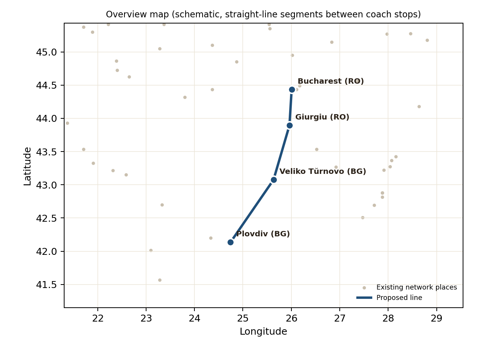

<div align="center">

# Europe East Coach Network Planner

**Network-planning analysis of the public FlixBus GTFS timetable for Central and Eastern Europe:
data validation with an issue tracker, timetable-checked transfers, demand gaps, a same-week network
changelog and a worked line case with a draft authorization dossier. Rebuilt every week.**

[](https://github.com/Kiran-koppera/europe-east-network-planner/actions/workflows/ci.yml)
[](https://github.com/Kiran-koppera/europe-east-network-planner/actions/workflows/refresh.yml)


### [▶ Live dashboard](https://kiran-koppera.github.io/europe-east-network-planner/) · [Issue tracker (xlsx)](https://kiran-koppera.github.io/europe-east-network-planner/data/data-quality-issue-tracker.xlsx) · [Worked case (docx)](https://kiran-koppera.github.io/europe-east-network-planner/data/dossier-bucharest-plovdiv.docx) · [Report pack (xlsx)](https://kiran-koppera.github.io/europe-east-network-planner/data/europe-east-network-report.xlsx)


</div>

> **Independent project.** Built on open data. Not affiliated with, endorsed by or using internal data of Flix.

---

## The problem

A network planning team keeps timetable data correct, tracks what changes from one feed to the next,
sees where the network is thin, and turns a promising city pair into a line partners, authorities and
sales can act on. This project does that groundwork from public data and refreshes it every Monday.

| Planning task | What the project produces |
|---|---|
| Data entry, tracking and validation | 15 quality checks per feed and an **Excel issue tracker** with lookups, formula flags, owner and status dropdowns |
| Tracking changes over the timetable year | A **changelog that compares two feeds on the same calendar week**, down to individual stops |
| Analysing the network to improve service | Weekly departures and fastest times for every city pair; **transfers checked against the timetable** |
| Adapting the offer to demand | A demand-gap ranking of 20,601 candidate city pairs touching Europe East |
| Reports, analyses and maps | Interactive map, Excel report pack, overview map per proposed line |
| Documentation for new line authorizations | A **worked case**: today's options, real stops, both timetables, vehicles, legal basis, handoff |

## Three case studies

### 1 · A real change between two feeds: line 1304 moves from Sieradz to Łódź

Comparing the 8 Nov and 15 Nov 2026 feeds (the older one from the
[transport.data.gouv.fr archive](https://transport.data.gouv.fr/datasets/reseau-europeen-flixbus-et-flixtrain))
on the week both cover, 23–29 Nov: line **1304 Warsaw – Dresden – Brussels** now calls at Łódź (12:10)
instead of Sieradz (13:07) and leaves Warsaw 20 minutes earlier. Łódź gains 8 direct pairs to Germany,
the Netherlands and Belgium; Sieradz loses 9. Comparing each feed's own first week instead, as the first
version of this project did, would have reported **17 changes that never happened**.
→ [Changelog case](docs/changelog-case.md)

### 2 · A worked planning case: Bucharest – Plovdiv

Four cities link both ends, but the timetable tells a different story: outbound, the only working
connection runs via **Istanbul in 18 h 45 min**; the return works via Sofia in 9 h 55 min. Outbound via
Sofia misses by 20 minutes, and even retimed it would take 12 h 15 min, above the 10 h 52 min practical
limit. A direct line via Giurgiu and Veliko Tarnovo takes **8 h 18 min**, using observed Flix running
times on 2 of 3 segments. It needs 4 coaches with departures at 07:30 and 15:00, or 2 if the second
departure moves to 16:45 (01:03 arrival). The handoff lists 7 open checks with owners and the sign-offs
needed before sales open. → [Worked case](docs/worked-case-bucharest-plovdiv.md)

### 3 · A tracked data-quality issue: Rokovci → Sopot R

68 segments on 12 stop pairs run faster than a coach can. In the tracker, DQ-SPD-001 shows 9 Zagreb –
Vukovar trips covering 7.3 km in 3 minutes (146 km/h, a formula evaluated from the Stops sheet), flagged
in both directions. A misplaced *Sopot R* coordinate is the suspected cause; the issue stays **Open**
until someone verifies it. → [Issue tracker](docs/issue-tracker.md)

## Results (snapshot 18 Nov 2026, reference week 23–29 Nov 2026)

| | |
|---|---|
| Feed processed | **273,100** stop times · 39,432 trips · 1,214 routes · 2,085 stops in 33 countries |
| Data quality | **15 checks**, 984,520 records, **0 errors**; 68 flagged segments → 12 tracked issues |
| Europe East network | **555 places** in all **15** countries, 100 cities ≥100k, **5,451** weekly departures |
| Connectivity | **9,560** direct city pairs, **56 %** of them cross-border |
| Demand model | 20,601 candidate pairs; rank correlation with today's frequencies **ρ = 0.446** on 2,022 served pairs |
| Top-50 opportunities, timetable-checked | 7 practical transfer, 3 practical one way only, 5 no practical transfer, 2 no direct link, 10 low frequency, 23 city not on network |
| Changelog (8 → 15 Nov feeds) | 1 stop added, 8 pairs added, 9 removed, 4 frequency increases, 3 decreases |
| Engineering | 31 tests, 93 % coverage · full run 6.5 s |

<p align="center"></p>

## How it works

```
 gtfs.gis.flix.tech/gtfs_generic_eu.zip      GeoNames cities15000
                │                                    │
   ingest  ─────┤  load, checksum, coerce times > 24:00
   quality ─────┤  15 checks → scorecard + Excel issue tracker
   geo     ─────┤  stop → largest same-country city within 12 km, else a town (name, 5 km)
   network ─────┤  reference-week runs → place-to-place legs → city pairs, country KPIs
   demand  ─────┤  gravity index → status; top 50 checked against the timetable (transfers)
   changelog ───┤  8-week snapshot; diff on a calendar week both feeds cover
   dossier ─────┤  worked case: options today, stops, timetables, vehicles, legal basis, handoff
   site    ─────┘  static JSON + Leaflet dashboard → GitHub Pages
```

A GitHub Actions workflow runs this every Monday at 05:00 UTC, fails on any data-quality **error**,
stores the snapshot on the `data-history` branch and redeploys the site. CI runs lint and tests on
Python 3.10 and 3.13 for every push.

Details: [method](docs/method.md) · [data-quality checks](docs/data-quality.md) · [line dossier](docs/line-dossier.md).

## Quick start

```bash
git clone https://github.com/Kiran-koppera/europe-east-network-planner.git
cd europe-east-network-planner
make install      # .venv + package + dev tools
make data         # download the feed (32 MB) and GeoNames cities
make run          # pipeline -> output/ (reports, site, metrics.json)
make serve        # http://localhost:8000
make test         # 31 tests
```

Every assumption (country scope, distance band, speed limits, exclusions, change window, timetable
parameters) is in [`src/planner/config.py`](src/planner/config.py) or at the top of its module.

## Project structure

```
├── src/planner/
│   ├── gtfs.py         load a feed from .zip or folder
│   ├── quality.py      15 data-quality checks, speed exceptions
│   ├── tracker.py      Excel issue tracker (lookups, formulas, dropdowns, summary)
│   ├── calendar.py     reference week, service days incl. exceptions
│   ├── geo.py          distances, stop → city / town
│   ├── network.py      legs, city pairs, country KPIs, 8-week series
│   ├── demand.py       gravity model, gap classification, calibration
│   ├── transfers.py    timed one-change itineraries, practical-transfer verdicts
│   ├── changelog.py    weekly snapshots, same-week diffs
│   ├── dossier.py      worked case and draft authorization dossier (.docx)
│   ├── excel.py        report pack
│   └── pipeline.py     end-to-end run
├── site/               dashboard (HTML, CSS, vanilla JS + Leaflet)
├── tests/              unit + end-to-end tests on a hand-built mini feed
├── data/history/       real snapshots of the 8 and 15 Nov 2026 feeds (ODbL)
├── docs/               method, checks, cases, images
└── .github/workflows/  ci.yml, refresh.yml
```

## Limits

- **No ridership data.** Public feeds have no ticket sales, so the demand index ranks potential and does not
  forecast passengers. ρ = 0.446 shows it explains part, not all, of today's service levels.
- **Transfers** are checked for the top 50 opportunities only, with one change and a 15–180 minute window;
  the bulk status for all candidates is "linked via hub (untimed)".
- **Running times** use observed Flix times where Flix drives the segment; other segments are estimates
  calibrated on the corridor and need a test drive or routing check.
- **Excluded areas.** Occupied and front-line regions of Ukraine (Kharkiv is not excluded: the feed serves it).
  Turkey is covered by a separate Flix feed.
- **Dossier.** A planning draft. Stop locations must be agreed locally; the competent authority's checklist prevails.

## Data and licences

- Timetable: FlixBus GTFS feed for Europe, published by Flixbus France on
  [data.gouv.fr](https://www.data.gouv.fr/datasets/5c6ad5248b4c411c3d7ae435) under the **ODbL 1.0**; earlier
  versions from the transport.data.gouv.fr archive. Derived data here is shared under the same licence.
- Population: [GeoNames](https://www.geonames.org/) `cities15000`, **CC BY 4.0**.
- Base map: © OpenStreetMap contributors. Code: **MIT**.
