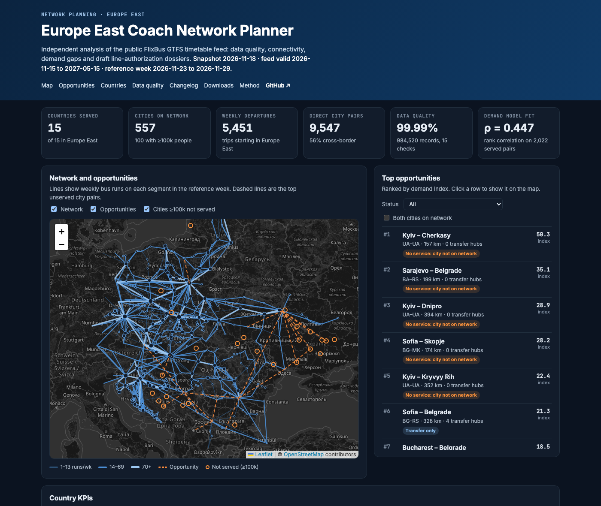

<div align="center">

# Europe East Coach Network Planner

**Network-planning analysis of the public FlixBus GTFS timetable for Central and Eastern Europe:
data validation, city-pair connectivity, demand gaps, a weekly network changelog and draft
line-authorization dossiers. Rebuilt and redeployed automatically every week.**

[](https://github.com/Kiran-koppera/europe-east-network-planner/actions/workflows/ci.yml)
[](https://github.com/Kiran-koppera/europe-east-network-planner/actions/workflows/refresh.yml)


### [▶ Live dashboard](https://kiran-koppera.github.io/europe-east-network-planner/) · [Excel report](https://kiran-koppera.github.io/europe-east-network-planner/data/europe-east-network-report.xlsx) · [Example line dossier](https://kiran-koppera.github.io/europe-east-network-planner/data/dossier-bucharest-plovdiv.docx) · [Method](docs/method.md)



</div>

> **Independent project.** Built on open data. Not affiliated with, endorsed by or using internal data of Flix.

---

## The problem

A network planning team has to keep timetable data correct, see where the network is thin, and turn a
promising city pair into an application an authority will accept. The data for all three sits in different
places. This project does the groundwork from public sources and refreshes it every Monday:

| Planning task | What the pipeline produces |
|---|---|
| Data entry, tracking and validation | 15 automated quality checks on every feed, with the IDs of the records to fix |
| Analysing the network to improve service | Weekly departures, fastest time and transfer options for every city pair |
| Adapting the offer to demand | A demand-gap ranking of 20,531 candidate city pairs touching Europe East |
| Tracking changes over the timetable year | A week-over-week changelog of places, connections and frequencies |
| Reports, analyses and maps | Interactive map, Excel report pack, overview map per proposed line |
| Documentation for new line authorizations | A draft dossier: legal basis, stops, map, timetable, attachments checklist |

## Results (snapshot 18 Nov 2026, reference week 23–29 Nov 2026)

All figures are produced by the pipeline from the feed valid 15 Nov 2026 – 15 May 2027.

| | |
|---|---|
| Feed processed | **273,100** stop times · 39,432 trips · 1,214 routes · 2,085 stops in 33 countries |
| Pipeline runtime | **2.8 s** end to end on a laptop |
| Data quality | **15 checks**, 984,520 records, **0 errors**, 68 flagged segments (99.993 % pass rate) |
| Europe East network | **557 cities** in all **15** countries, 100 of them with ≥100k people, **5,451** weekly departures |
| Connectivity | **9,547** direct city pairs, **55.7 %** of them cross-border |
| Demand model | 20,531 candidate pairs; rank correlation with today's frequencies **ρ = 0.447** on 2,022 served pairs |
| Gaps | 3,022 pairs with no direct link, 9,830 transfer-only, 728 low-frequency; **26** cities ≥100k without a stop |

### Findings worth a planner's attention

- **Highest-ranked gaps between cities already on the network:** Sofia – Belgrade and Bucharest – Belgrade
  (transfer only, 4 and 17 possible change points), Bucharest – Odesa (transfer only), Warsaw – Olsztyn and
  Niš – Belgrade (fewer than 14 departures a week).
- **Example dossier:** Bucharest – Plovdiv (rank 18, transfer only today) is the top intra-EU cross-border
  gap. The generated dossier routes it via Ruse and Veliko Tarnovo (351 road km), cites Regulation (EC)
  No 1073/2009 and inserts the 45-minute break required after 4.5 h of driving.
- **Data quality:** the one warning is real: trips Zagreb – Vukovar reach 145 km/h between *Rokovci* and
  *Sopot R*, then 44 km/h for the next 2 km. That pattern usually means a misplaced stop coordinate
  (9 trips per direction affected).

<p align="center"></p>

## How it works

```
 gtfs.gis.flix.tech/gtfs_generic_eu.zip      GeoNames cities15000
                │                                    │
   ingest  ─────┤  load, checksum, coerce times > 24:00
   quality ─────┤  15 checks: structure, references, timing, speeds, calendars
   geo     ─────┤  stop → city (largest city within 12 km)
   network ─────┤  reference-week runs → place-to-place legs → city pairs, country KPIs
   demand  ─────┤  gravity index → status: not on network / no direct / transfer only / low frequency
   changelog ───┤  compare with last week's gzipped snapshot (data-history branch)
   reports ─────┤  Excel pack · Word dossier · overview map
   site    ─────┘  static JSON + Leaflet dashboard → GitHub Pages
```

A GitHub Actions workflow runs this every Monday at 05:00 UTC, fails the build if any data-quality
**error** appears, stores the new snapshot on the `data-history` branch and redeploys the site. CI runs lint and tests on Python 3.10
and 3.13 for every push (3.9 is supported and tested locally).

Details: [method](docs/method.md) · [data-quality checks](docs/data-quality.md) · [line dossier](docs/line-dossier.md).

## Quick start

```bash
git clone https://github.com/Kiran-koppera/europe-east-network-planner.git
cd europe-east-network-planner
make install      # .venv + package + dev tools
make data         # download the feed (32 MB) and GeoNames cities
make run          # pipeline -> output/ (reports, site, metrics.json)
make serve        # http://localhost:8000
make test         # 19 tests, 92 % coverage
```

Every assumption (country scope, distance band, speed limits, exclusions, timetable parameters) is in
[`src/planner/config.py`](src/planner/config.py).

## Project structure

```
├── src/planner/
│   ├── gtfs.py         load a feed from .zip or folder
│   ├── quality.py      15 data-quality checks and scorecard
│   ├── calendar.py     reference week, service days incl. exceptions
│   ├── geo.py          distances, stop → city assignment
│   ├── network.py      legs, city pairs, country KPIs
│   ├── demand.py       gravity model, gap classification, calibration
│   ├── changelog.py    weekly snapshots and diffs
│   ├── dossier.py      draft authorization dossier (.docx) with map and timetable
│   ├── excel.py        report pack
│   └── pipeline.py     end-to-end run
├── site/               dashboard (HTML, CSS, vanilla JS + Leaflet)
├── tests/              unit + end-to-end tests on a hand-built mini feed
├── data/history/       baseline snapshot; weekly snapshots live on the data-history branch (ODbL)
├── docs/               method, checks, dossier, images
└── .github/workflows/  ci.yml, refresh.yml
```

## Limits

- **No ridership data.** Public feeds have no ticket sales, so the demand index ranks potential and does not
  forecast passengers. The ρ = 0.447 fit shows it explains part, not all, of today's service levels.
- **Excluded areas.** Occupied and front-line regions of Ukraine are excluded from candidates; the list is a
  setting to review as the situation changes. Turkey is covered by a separate Flix feed and is excluded.
- **Feed scope.** The EU feed is the only source; services published in other national feeds are not counted.
- **Dossier.** A planning draft. Stop locations must be agreed locally and the competent authority's own
  checklist prevails.

## Data and licences

- Timetable: FlixBus GTFS feed for Europe, published by Flixbus France on
  [data.gouv.fr](https://www.data.gouv.fr/datasets/5c6ad5248b4c411c3d7ae435) under the **ODbL 1.0**.
  Derived data in this repository and on the site is shared under the same licence.
- Population: [GeoNames](https://www.geonames.org/) `cities15000`, **CC BY 4.0**.
- Base map: © OpenStreetMap contributors.
- Code: **MIT**.
